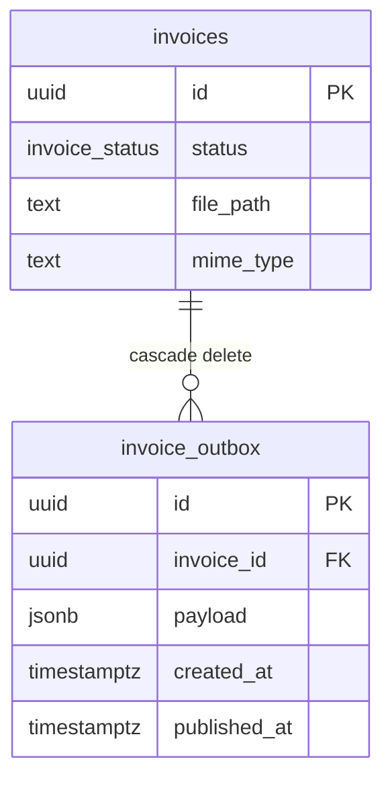

# Spec: Transactional outbox for PROCESS_INVOICE

**Author:** agent  
**Date:** 2026-10-23

## Thesis

Рядок інвойса і подія `PROCESS_INVOICE` комітяться однією транзакцією Postgres, а окремий relay у тому самому процесі Node публікує неопубліковані рядки в Redpanda.

## Problem

Завантаження і retry спочатку комітять `uploaded`, і лише потім викликають `producer.send`. Якщо `send` кидає виняток, процес ще живий і компенсує: завантаження стирає рядок і файл (`503`), retry повертає `failed`. Смерть процесу між commit і send компенсацію не запускає. Інвойс лишається `uploaded` без повідомлення в топіку. Consumer сам його не підхоплює, а кнопка retry дозволена лише з `failed`.

## User Goal

Після прийнятого завантаження або успішного retry рахунок не зависає в `uploaded` через збій публікації. Повторний запуск сервера або наступний прохід relay доставляє завдання. Помилка брокера дає повтор, не втрату рядка.

## Scenarios

### AS-001: Завантаження пише інвойс і outbox однією транзакцією

- WHEN: валідний файл проходить перевірку підпису і розміру
- THEN: один `BEGIN`/`COMMIT` вставляє рядок `invoices` зі статусом `uploaded` і рядок `invoice_outbox` з тим самим `invoice_id`; `payload.eventId` дорівнює первинному ключу outbox; `publisher.publish` не викликається до `COMMIT`; після commit відповідь `202` містить `id`, показне ім'я і `uploaded`, а хаб шле `INVOICE_STATUS_CHANGED` зі статусом `uploaded`
- IF: вставка outbox кидає виняток, THEN транзакція робить `ROLLBACK`, збережений файл прибирається, `publish` не викликається, клієнт не отримує `202`
- Verify: `npm run test:unit -w server -- src/services/enqueue-invoice.test.ts src/services/upload-invoice.test.ts`
- Criteria:
  - [ ] Обидва записи відбуваються на одному клієнті між `BEGIN` і `COMMIT`
  - [ ] `publish` стоїть після `COMMIT`
  - [ ] Збій вставки outbox відкочує транзакцію і стирає файл

### AS-002: Помилка брокера після commit не знищує інвойс

- WHEN: транзакція завантаження або retry вже закомічена, а `publisher.publish` кидає виняток
- THEN: рядок лишається `uploaded`, файл завантаження лишається на диску, у outbox `published_at` порожній; завантаження відповідає `202`, retry відповідає `200` і не повертає попередній `failed`; виняток лише логується
- IF: падає сама транзакція Postgres, THEN успішна відповідь не повертається, а для нового файлу записаний файл прибирається
- Verify: `npm run test:unit -w server -- src/services/upload-invoice.test.ts src/services/retry.test.ts`
- Criteria:
  - [ ] Немає видалення рядка і файлу після помилки `publish`
  - [ ] Retry не виконує перехід назад у `failed`
  - [ ] `503 broker_unavailable` з цих двох шляхів не повертається

### AS-003: Relay публікує неопублікований рядок і повторює після збою

- WHEN: у `invoice_outbox` є рядок з `published_at IS NULL` і drain запускається знову
- THEN: relay викликає `publisher.publish` з ключем `invoiceId` і тілом `payload`, і лише після успішного send ставить `published_at`; другий drain цей рядок більше не шле
- IF: `send` кидає виняток, THEN `published_at` не ставиться, а наступний drain шле той самий рядок знову
- Verify: `npm run test:unit -w server -- src/services/outbox-relay.test.ts`
- Criteria:
  - [ ] Позначка пишеться після успішного send, не до нього
  - [ ] Невдалий send лишає рядок неопублікованим
  - [ ] Повторний drain після успіху не публікує той самий рядок

### AS-004: Retry комітить перехід і outbox разом

- WHEN: `POST /api/invoices/:id/retry` бачить статус `failed`
- THEN: одна транзакція переводить рядок у `uploaded` (`retry_count` на 1 більший, `error_message` порожній) і вставляє outbox; програна гонка (`UPDATE` не змінив рядок) робить `ROLLBACK` і не вставляє outbox
- IF: статус уже не `failed`, THEN відповідь `409` з поточним статусом і нового рядка outbox немає
- Verify: `npm run test:unit -w server -- src/services/enqueue-invoice.test.ts src/services/retry.test.ts`
- Criteria:
  - [ ] Перехід і insert outbox ділять один `COMMIT`
  - [ ] Програний `UPDATE` не залишає outbox
  - [ ] Не-`failed` далі дає `409`

### AS-005: Добір підхоплює uploaded без жодного outbox

- WHEN: drain бачить інвойс у статусі `uploaded`, для якого немає жодного рядка `invoice_outbox`
- THEN: перед публікацією він вставляє рівно одну подію `PROCESS_INVOICE` (`eventId` дорівнює id outbox, шлях і MIME з рядка інвойса) і далі публікує її як звичайний неопублікований рядок
- IF: outbox для цього інвойса вже є, навіть із заповненим `published_at`, THEN другий рядок outbox не створюється
- Verify: `npm run test:unit -w server -- src/db/outbox.test.ts src/services/outbox-relay.test.ts`
- Criteria:
  - [ ] Добір обмежений статусом `uploaded` і відсутністю будь-якого outbox
  - [ ] Інвойс із наявним outbox не дублюється
  - [ ] `processing` цим добором не чіпається

## Constraints

- Той самий один процес Node. Окремого сервісу relay немає.
- Relay і запит ділять один mutex-ланцюжок: другий drain не стартує, доки попередній не завершився, але запит, що прийшов під час drain, ставить ще один прохід після нього.
- Інтервал повторів — 1 секунда. Перший drain на старті сервера не валить процес, якщо брокер недоступний: помилка логується, слухач HTTP усе одно піднімається.
- Повторна публікація дозволена. Consumer не змінюється: у `processing` він переходить лише з `uploaded`.
- Схема додається в `server/src/db/init.sql`. Окремого мігратора немає.
- Нові файли TypeScript не довші за 200 рядків. Функції не довші за 50 рядків.
- `published_at` оновлюється умовою `published_at IS NULL`.

## Out of Scope

- Ключ ідемпотентності завантаження. Повторне надсилання того самого файлу після втраченої HTTP-відповіді як і раніше створює другий інвойс.
- Відновлення рядків `processing`, коли том Redpanda знищено (`docker compose down` і новий `up`).
- Журнал SSE, `Last-Event-ID`, кілька процесів Node, заміна KafkaJS.
- Перепис специфікації, плану і задач фічі 001.

## Entity Model

`invoice_outbox.id` є `payload.eventId`. `payload` — це `ProcessInvoiceEvent`. Видалення інвойса прибирає його outbox каскадом.

## Open Questions

Немає. Межу «лише outbox» підтверджено: варіанти були `outbox` і `outbox-and-idempotency`, обрано `outbox`.
